<div align="center">

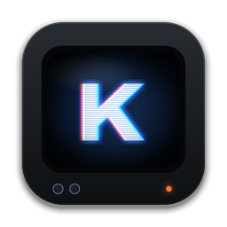

# KILN

**Analogue video emulator for macOS**

Run a video, still picture, camera, or stream through a simulated analogue signal,<br>
tape transport and CRT screen, then export to H.264, HEVC, ProRes 422, or ProRes 4444

-1f2328)


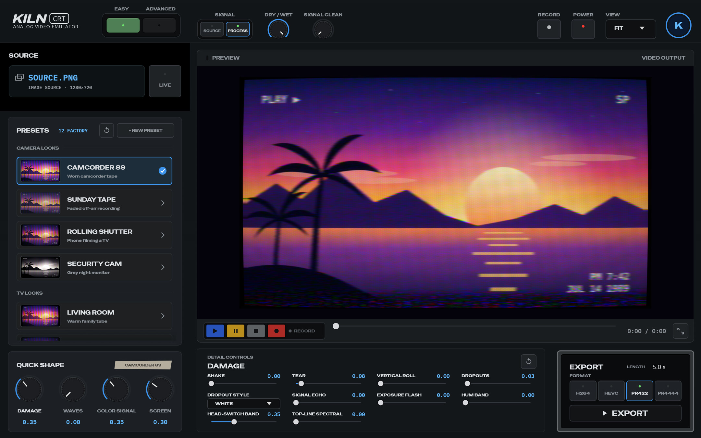

</div>

## Contents

- [What it does](#what-it-does)
- [Looks](#looks)
- [The rack](#the-rack)
- [Download](#download)
- [Build](#build)
- [Using KILN](#using-kiln)
- [Render from the command line](#render-from-the-command-line)
- [Licences](#licences)

## What it does

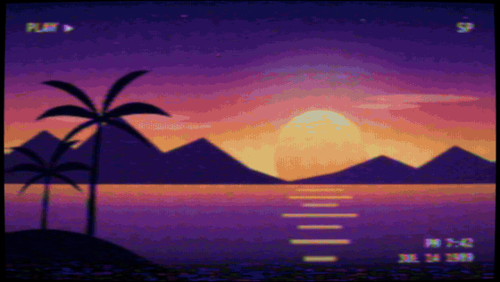

- **Simulated signal path** Colour bleed, chroma drift, head-switch bands, dropouts, tearing,
  vertical roll, ghosting, hum bars, snow and grit, then a picture tube with a phosphor mask,
  curvature, glow and halation on top
- **Different sources** Drop in a video or a picture, or press **LIVE** for a camera, a capture
  device, the screen or a stream address
- **Presets and knobs** Twelve factory looks, your own saved beside them. **EASY** has
  four main knobs, **ADVANCED** opens every module
- **Recreatahble** **RECORD** captures your knob moves while the video plays, and the export
  renders them into the file
- **Clean exports** H.264, HEVC, ProRes 422 or ProRes 4444 at SD, HI or source quality, from
  the window or from the command line

<br clear="right">

### Before and after

| Source | Through KILN (`CAMCORDER 89`) |
| :---: | :---: |
| 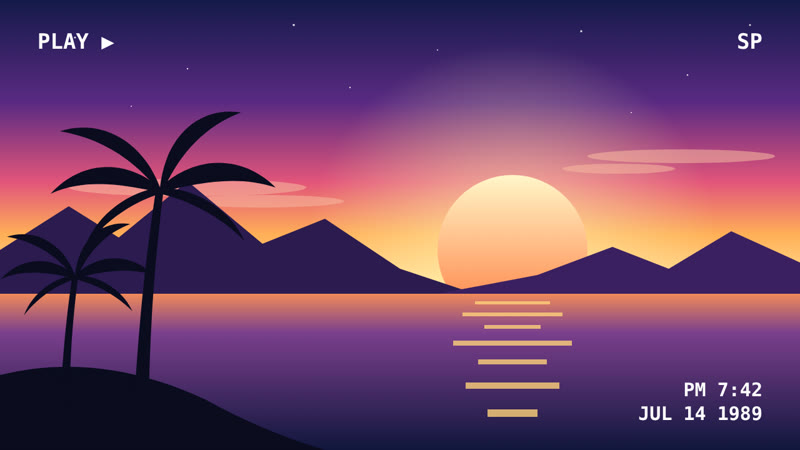 | 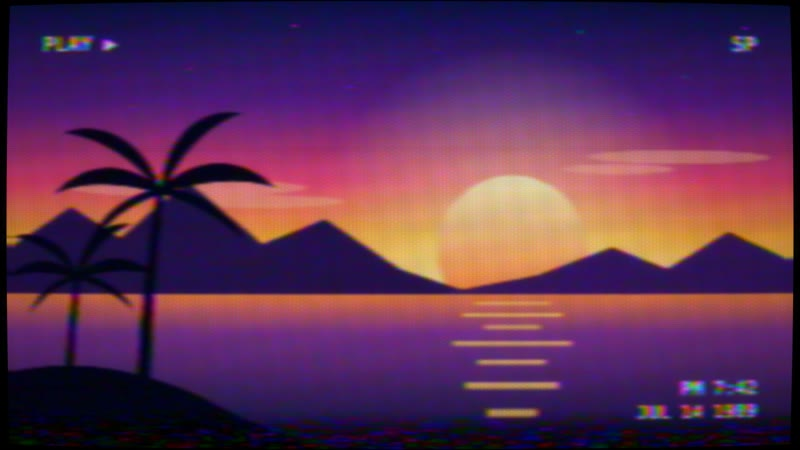 |

## Looks

The twelve factory presets, all rendered from the same picture.

**Camera**

| | | | |
| :---: | :---: | :---: | :---: |
|  | 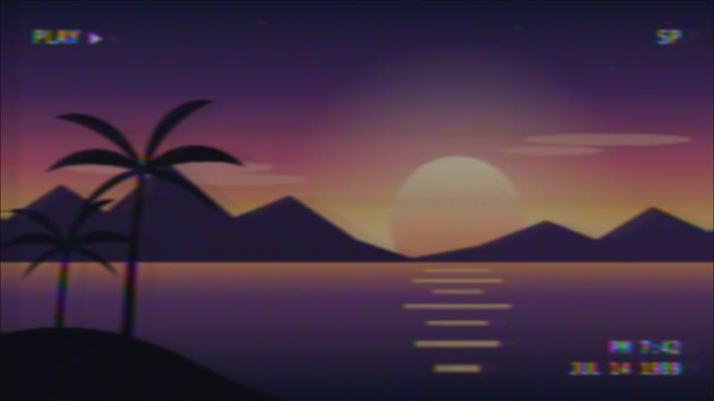 | 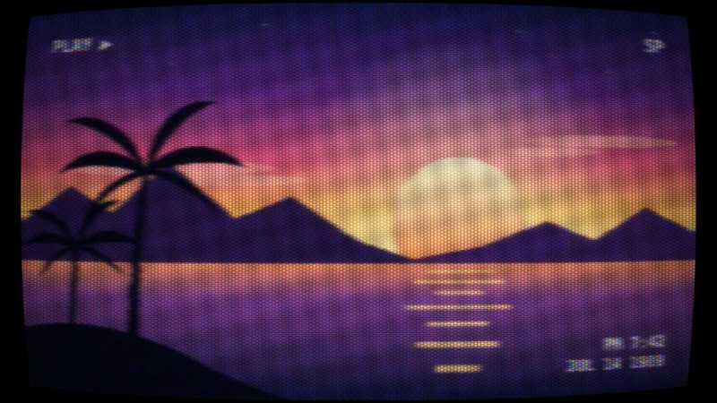 | 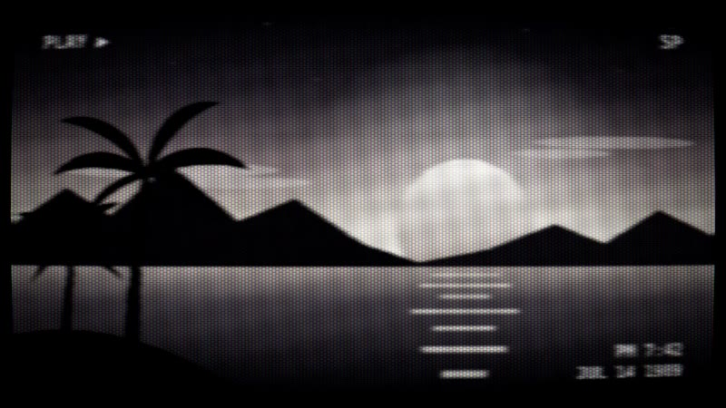 |
| **CAMCORDER 89**<br>Worn camcorder tape | **SUNDAY TAPE**<br>Faded off-air recording | **ROLLING SHUTTER**<br>Phone filming a TV | **SECURITY CAM**<br>Grey night monitor |

**TV**

| | | | |
| :---: | :---: | :---: | :---: |
| 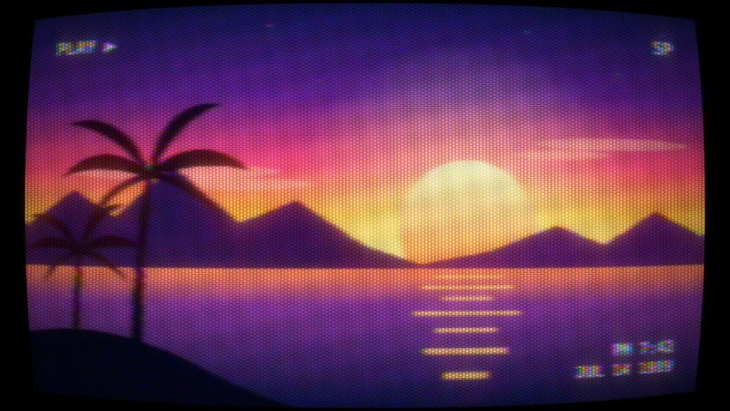 | 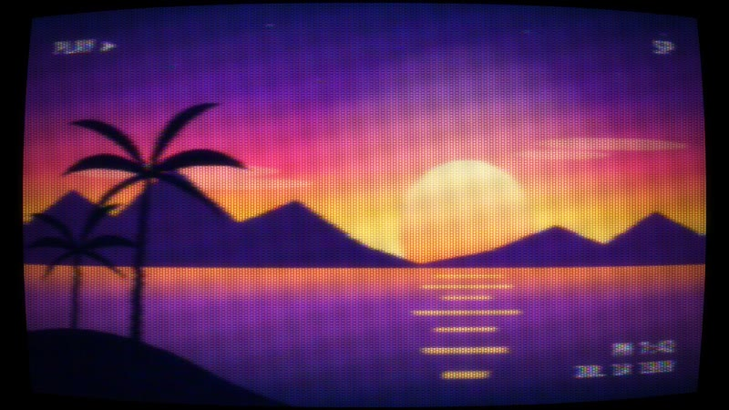 | 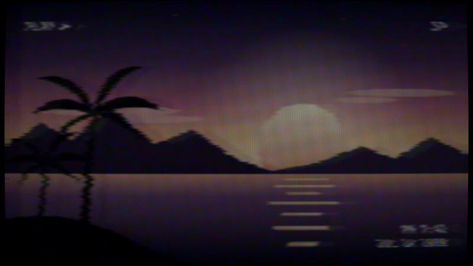 | 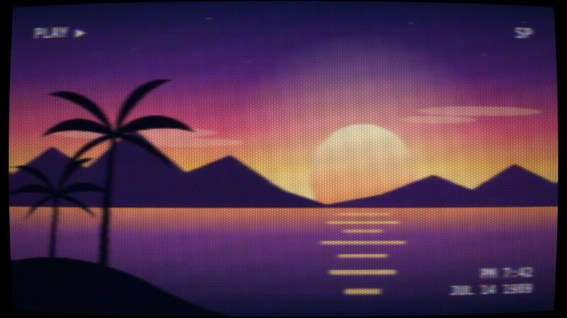 |
| **LIVING ROOM**<br>Warm family tube | **ARCADE CABINET**<br>Sharp mask with glow | **LOST SIGNAL**<br>Weak aerial reception | **STUDIO MONITOR**<br>Clean broadcast reference |

**FX**

| | | | |
| :---: | :---: | :---: | :---: |
| 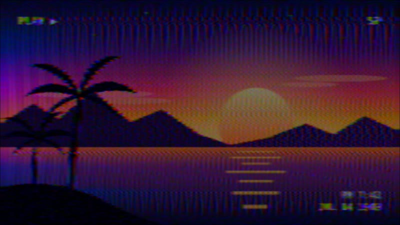 | 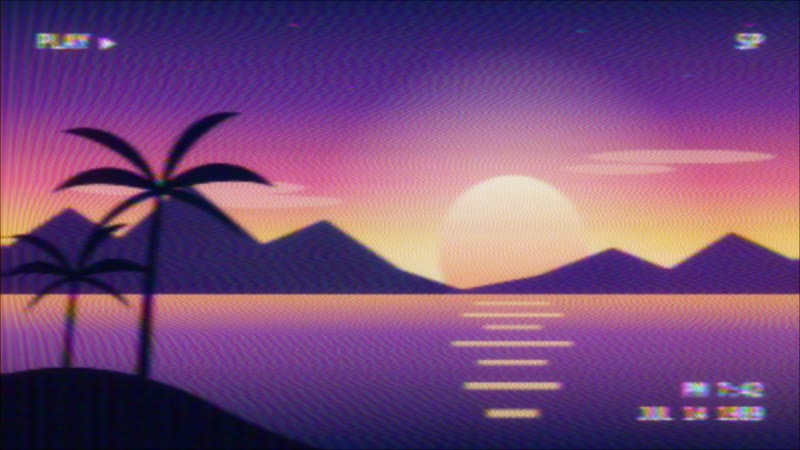 | 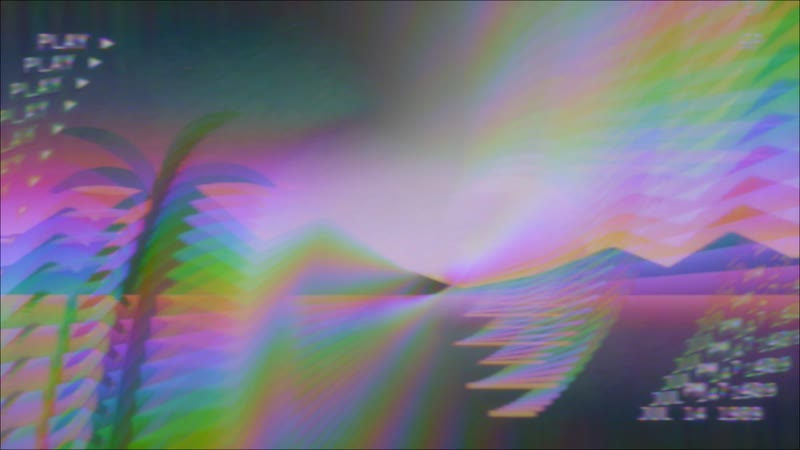 | 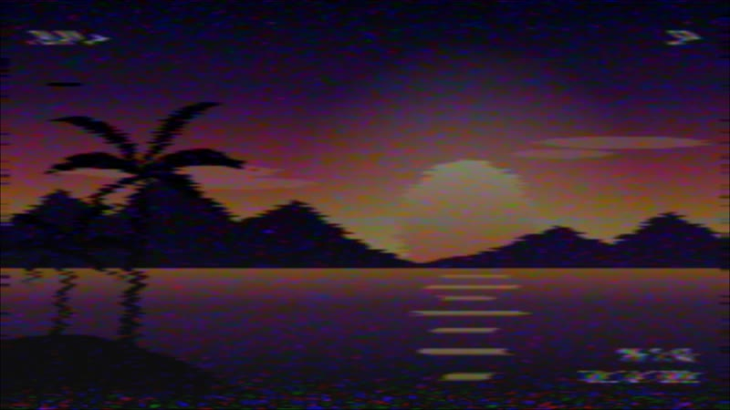 |
| **MELTDOWN**<br>Bent and overdriven | **TIDE POOL**<br>Slow liquid waves | **ECHO CHAMBER**<br>Spiralling video feedback | **STATIC STORM**<br>Everything falling apart |

## The rack

**ADVANCED** shows every module, each with its own knob, reset and full set of controls.

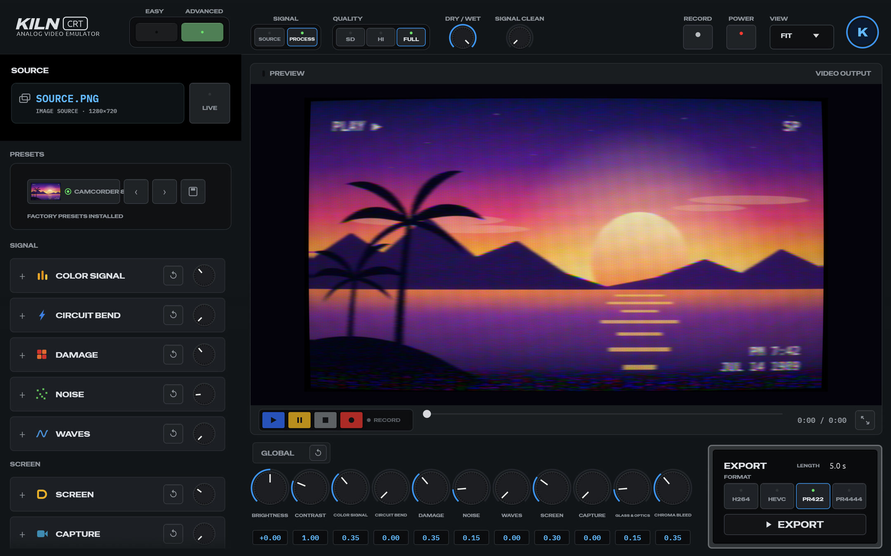

| Signal | |
| :--- | :--- |
| **COLOR SIGNAL** | Bleed, drift, burn, chroma bleed, RGB shift, sharpening |
| **CIRCUIT BEND** | A resonant filter pushed into the signal, with motion and feedback |
| **DAMAGE** | Shake, tear, vertical roll, dropouts, hum band, signal echo, head-switch band |
| **NOISE** | Sparkle and grit |
| **WAVES** | Slow modulation that reacts to the picture |

| Screen | |
| :--- | :--- |
| **SCREEN** | Tube, phosphor mask, bloom, flicker. Five screen types: slot mask, aperture grille, delta dot, fine slot mask, square grid |
| **CAPTURE** | What a camera sees pointed at the tube: shutter pulse, moiré, rainbow interference |
| **CONVERGENCE** | Colour fringing and phosphor misconvergence |
| **GLASS & OPTICS** | Glow, curvature, stretch, fisheye |

## Download

Get the disk image from [Releases](https://github.com/StaunchLemur29/KILN/releases). KILN runs on
**Apple Silicon Macs only** (M1 or later) with macOS 15 or newer; Intel Macs are not supported.
The app isn't notarized: the first time you open it, go to System Settings → Privacy & Security
and choose **Open Anyway**

## Build

Needs Rust (stable) and FFmpeg (`brew install ffmpeg`).

```sh
cargo build --release          # the program: target/release/kiln
bash package/make_app.sh       # KILN.app and an installer disk image in dist/
```

`make_app.sh` copies FFmpeg and the libraries it uses into the app, so the finished app runs
on Macs without Homebrew

## Using KILN

1. Drop a video or picture on the window, or press **BROWSE**.
2. Pick a look from **PRESETS**, then fine-tune it with **QUICK SHAPE** or the detail controls.
3. Switch to **ADVANCED** for every module and knob. **DRY / WET** blends the effect with the
   clean picture, and **SOURCE / PROCESS** compares the two.
4. Press **EXPORT**.

<kbd>Space</kbd> plays and pauses. The round **K** badge opens About. Your own presets and the
last session are kept in `~/Library/Application Support/KILN`.

The first time you use **LIVE** with a camera, macOS asks whether KILN may use it: choose Allow.

## Render from the command line

```sh
kiln --headless-export input.mp4 output.mov "PRESET=My Look" HI prores4444
```

After the two files, any of these, in any order. Later words win.

| Option | Meaning |
| :--- | :--- |
| a preset name, or `PRESET=<name>` | The whole look, quality included |
| `SD` / `HI` / `SOURCE` | Quality |
| `DISPLAY=0`–`4` | Screen type |
| `h264` / `hevc` / `prores422` / `prores4444` | File format |

| Exit code | Meaning |
| :---: | :--- |
| 0 | Done |
| 1 | Render failed |
| 64 | Wrong usage |
| 79 | Preset not found |

Inside the app the program is `KILN.app/Contents/MacOS/KILN`.

To save a picture of the window itself (this is how the screenshots above were made):

```sh
kiln --screenshot shots/window.png input.png              # easy mode
kiln --screenshot shots/window.png --advanced input.png   # advanced mode
```

## Licences

- KILN's own code: MIT (see [LICENSE](LICENSE)).
- Fonts in `assets/fonts`: SIL Open Font License (licence files beside them).
- FFmpeg (bundled in built apps only): LGPL/GPL, depending on how it was built. A Homebrew
  build includes GPL parts (x264, x265), so anyone you give a built app to must also be able to
  get FFmpeg's source. The licence texts go into the app under `Contents/Resources/Licenses`.

---

KILN is an independent project. It isn't affiliated with, endorsed by or connected to any other
analog-video product or its makers.
